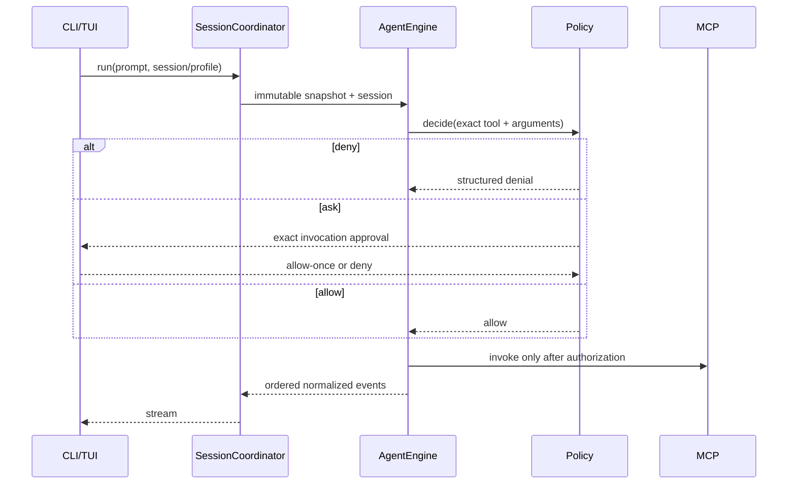

# Architecture

## Dependency direction

```text
shared
├── config       ├── model-registry       ├── auth       ├── policy       └── sessions
│                │                        │              │
└────────────────┴──── profiles / llm-runtime / mcp-client
                                      │
                                  agent-core
                                      │
                                   app-core
                                      │
                                  apps/cli
```

Packages depend only toward the left/upstream side of this graph. CLI commands and Ink views call the `CliApplication`/`PlinthwayApplication` boundary; they do not open SQLite, invoke provider SDKs, or connect MCP transports directly.

Provider-specific AI SDK objects are lazy and remain behind `LLMRuntime`. MCP stdio and Streamable HTTP results are size-limited, schema-validated, normalized as untrusted JSON, and passed through policy before invocation.

## MCP connection generations

`McpManager` owns one official SDK client per enabled server. `McpSupervisor` starts at
most eight of the profile's maximum 25 servers concurrently and returns a partial,
inspectable generation after ten seconds. Retryable failures reconnect with one-to-sixty
second jittered backoff; incompatible configuration and missing authentication do not
spin. Catalog entries retain server provenance and are removed before reconnect.

Modern connections use stateless `2026-07-28` request metadata and `server/discover`.
Negotiation can fall back only to initialization-based 2025 revisions. Plinthway-owned
ports isolate the rest of the application from SDK types. Capability catalogs cover tools,
prompts, resources/templates, Tasks, Skills, and Apps; the interaction broker owns roots,
sampling, elicitation, progress, and logging. See [MCP client](mcp.md) for the complete
surface and migration rules.

## Execution sequence



Each execution has a bounded step count, provider and tool timeouts, cancellation propagation, and exactly one terminal outcome. Provider output and MCP results cannot expand privileges.

## Transactional profile switching

```text
IDLE/ACTIVE → PREPARING → QUIESCING → COMMITTING → ACTIVE
                       ↘ failure/cancel ↘ ROLLING_BACK → prior ACTIVE
```

The target model and MCP dependencies are prepared before durable active-profile state changes. Active work must finish or be explicitly cancelled. A failed commit is compensated back to the prior usable snapshot, and outstanding approval grants are invalidated at the boundary.

## Session event model

SQLite stores the immutable effective-profile JSON and SHA-256 hash with the session. `session_events` is ordered by `(session_id, sequence)` and contains execution start, user/assistant messages, model selection, tool request, policy and approval decisions, untrusted tool result, usage, error, and terminal/interrupted events. Event append plus status update is atomic.

On restart, a session left `running` receives an `execution-interrupted` event. Tool requests without matching results are reported as pending. Resume restores the saved snapshot; selecting a different profile creates a child session whose history points to an explicit parent sequence.

## Error and exit contracts

| Class                                 | Representative codes                                                      | CLI exit |
| ------------------------------------- | ------------------------------------------------------------------------- | -------: |
| Usage/config/profile/model capability | `CONFIG_*`, `PROFILE_*`, `MODEL_NOT_FOUND`, `CAPABILITY_UNSUPPORTED`      |        2 |
| Credentials/authentication            | `CREDENTIAL_MISSING`, `AUTH_FAILED`                                       |        3 |
| Provider/registry/MCP/network         | `PROVIDER_ERROR`, `RATE_LIMITED`, `REGISTRY_*`, `MCP_*`, `NETWORK_DENIED` |        4 |
| Policy/cancellation                   | `TOOL_DENIED`, `APPROVAL_REQUIRED`, `CANCELLED`                           |        5 |
| Storage/internal/other                | `STORAGE_*`, unexpected failures                                          |        1 |

Errors exposed at process boundaries are typed and redacted. Unknown exceptions become a generic internal error rather than leaking provider or credential details.
